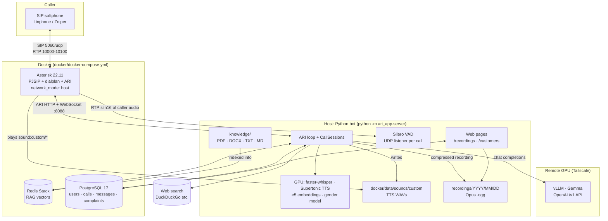
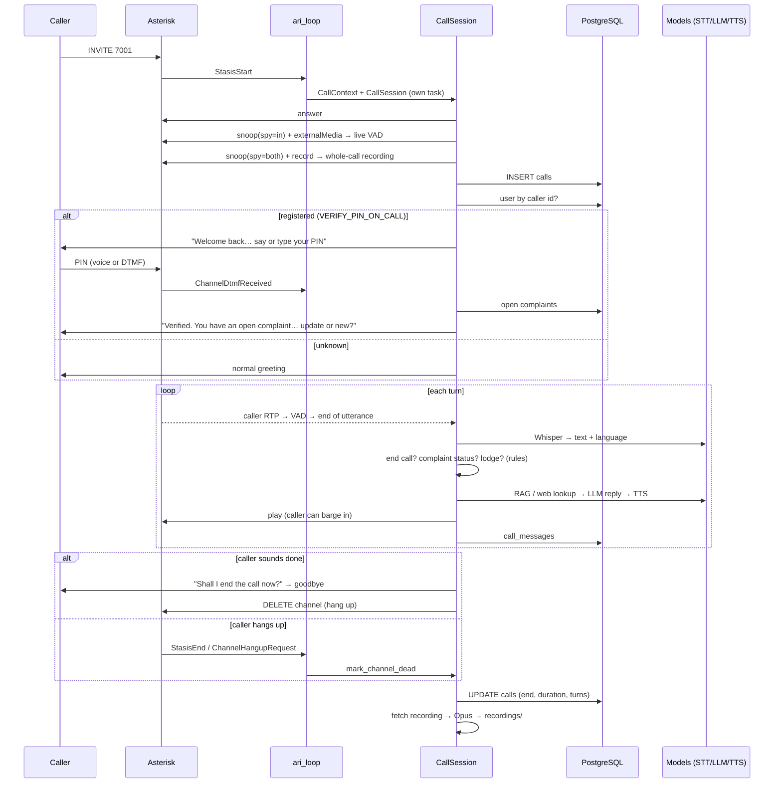
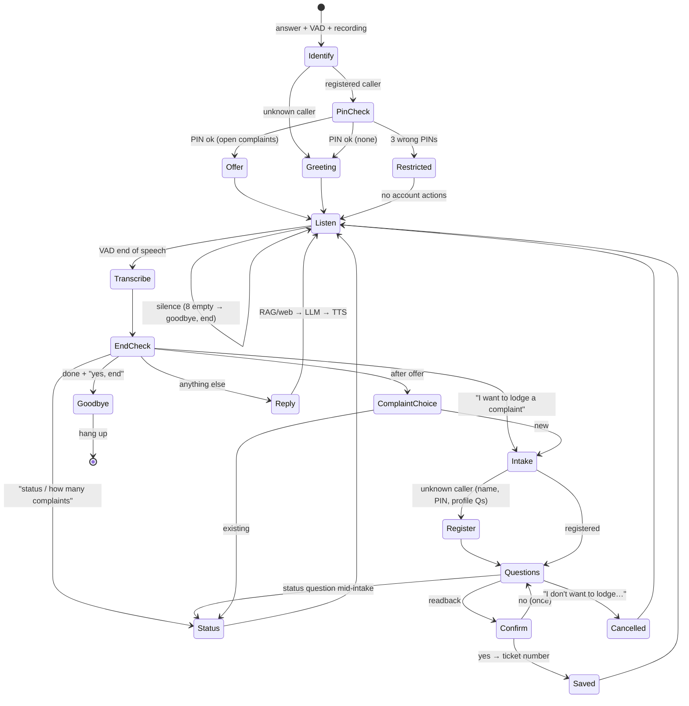
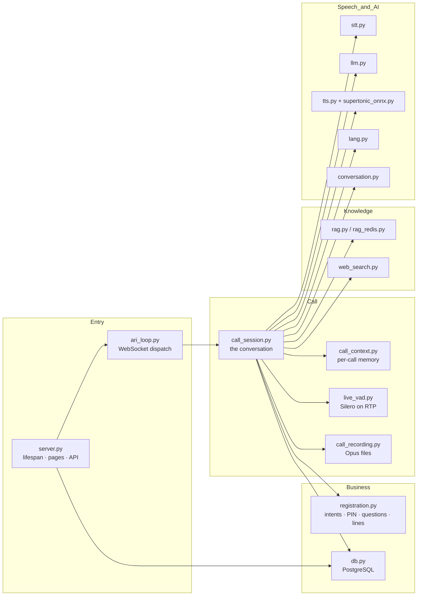
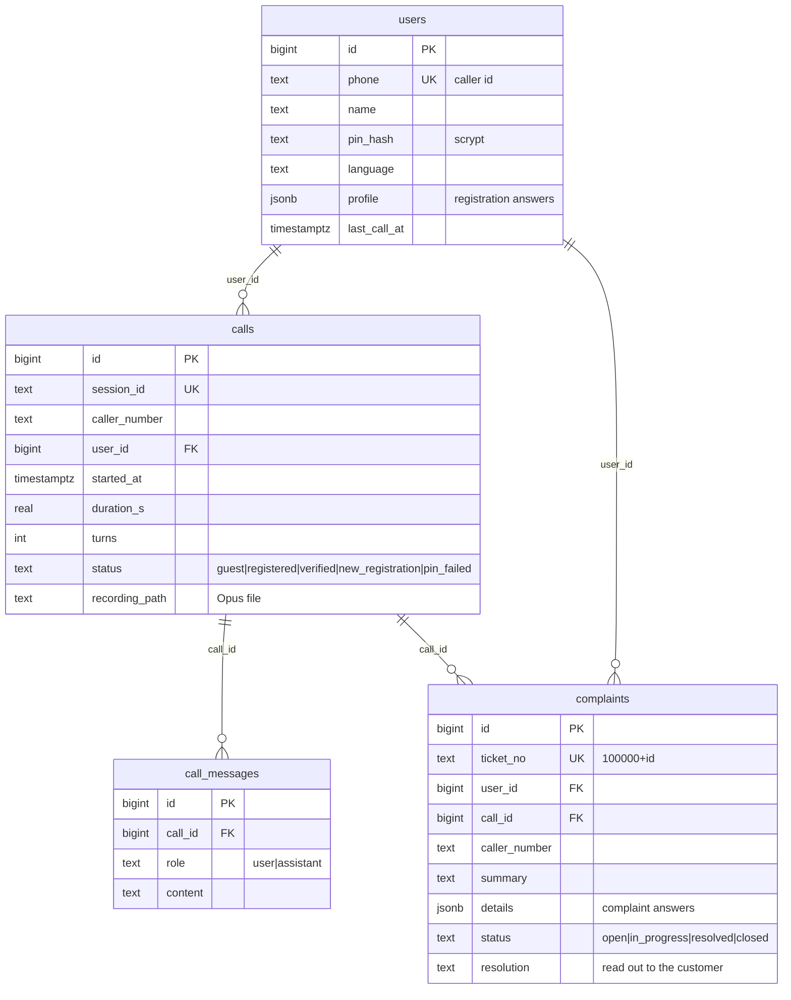

# Harvix AI Calling: Architecture

A phone call assistant. A SIP caller dials an extension, Asterisk hands the call to a Python app over ARI, and the app runs the conversation:

- it listens with live voice detection,
- transcribes with Whisper,
- answers from your documents, the web or an LLM,
- speaks with a local TTS,
- looks callers up in PostgreSQL, registers them, takes complaints and records the call.

One Python process handles many calls at once. Each call has its own `CallSession`.

For a step-by-step walk through a single call (which function runs when), see [docs/CALL_FLOW.md](docs/CALL_FLOW.md). For changing prompts and questions, see [docs/CUSTOMIZING.md](docs/CUSTOMIZING.md).

---

## System context



Everything except vLLM runs on one machine. Asterisk, Redis and PostgreSQL run in Docker; the bot runs on the host because it needs the GPU. Redis and PostgreSQL are optional: without them the bot uses a local RAG index and treats every caller as a guest.

## Processes and ports

| Process | Start | Ports (all `127.0.0.1` except SIP/RTP) |
|---|---|---|
| Asterisk | `cd docker && docker compose up -d asterisk` | SIP 5060/udp, RTP 10000–10100/udp, ARI 8088 |
| Redis Stack | `docker compose up -d redis` | 6379 |
| PostgreSQL | `docker compose up -d postgres` | 5432 |
| Bot + web pages | `python -m ari_app.server` (conda env `py311`) | 8765 (`UVICORN_PORT`) |
| vLLM | remote GPU server | 8000 (`VLLM_BASE_URL`) |

Asterisk's settings live in `docker/.env`: phone passwords, ports, codecs (`CODECS=ulaw,alaw,g722`) and `EXTERNAL_IP`. `docker/render.sh` fills the templates in `docker/asterisk/*.conf` from that file when the container starts. The bot's settings live in the project `.env`.

## Startup (`server.py` lifespan)

1. Configure the inference thread pool (Whisper / TTS concurrency limits).
2. Warm up the models: Supertonic voices, Whisper `medium`, the gender model, Silero VAD, the RAG embedding model and index (Redis, or local as a fallback).
3. Check that vLLM is reachable ("vLLM reachable at …").
4. Start `run_ari_forever()`: connect to PostgreSQL (`db.init`, which creates tables and columns if missing), then open the ARI WebSocket for app `callbot`.
5. Serve `/health`, `/recordings`, `/customers` and the JSON API.

One Ctrl+C stops everything within a few seconds: open browser connections and the database pool are each given a time limit.

---

## A call, end to end



## Per-call flow (decisions inside a turn)



---

## Package layout (`ari_app/`)



### Module responsibilities

| Module | Responsibility |
|---|---|
| `server.py` | FastAPI app: startup warm-up, `/health`, the `/recordings` and `/customers` pages, JSON API, time-limited shutdown |
| `ari_loop.py` | ARI WebSocket. `StasisStart` creates a `CallSession`; routes `PlaybackFinished`, `Recording*`, `ChannelDtmfReceived`, `StasisEnd` / `ChannelHangupRequest` / `ChannelDestroyed` (hang-up) |
| `call_session.py` | The conversation: answer, VAD setup, identify/PIN, turn loop, complaint flow, confirmation, end-of-call, play/record/hangup over ARI, DB logging, recording |
| `call_context.py` | Per-call memory: history, language, gender, DB ids, `user_status`, open tickets for the LLM; `message_listener` hook → `call_messages` |
| `live_vad.py` | UDP RTP listener plus Silero VAD; `listen` / `barge` modes; end-of-utterance; `fresh` re-arm to drop echo |
| `call_recording.py` | Recording paths, ffmpeg → Opus (16 kbps, ~60 KB/min), safe path resolving for the web page |
| `registration.py` | Intent rules (lodge / status / cancel / end call / yes-no / skip), `parse_pin` / `parse_digits`, echo stripping, question files, LLM extraction of names and answers, every fixed sentence in English and Hindi (`_LINES`) |
| `db.py` | asyncpg pool and schema; users (scrypt PIN hash, `profile` JSON), calls, messages, complaints (`ticket_no`, `status`, `resolution`), admin queries |
| `rag.py` / `rag_redis.py` | Index `knowledge/` (multilingual-e5-small); search via Redis HNSW KNN, or local numpy + BM25 |
| `web_search.py` | Free web search tiers with backoff; formats results for the LLM |
| `stt.py` | faster-whisper (CUDA float16), language detection, optional initial prompt |
| `llm.py` | System prompts (persona, rules, caller info, complaint rules), history alternation for Gemma, the web-lookup classifier, vLLM client |
| `tts.py`, `supertonic_onnx.py` | Supertonic on GPU; ffmpeg to 8 kHz `.wav` + 16 kHz `.wav16`; loudness and trimming |
| `lang.py` | Per-turn reply-language detection; caller can pin a language by name |
| `conversation.py` | Trim replies for the phone, split into TTS chunks, numbers and phone numbers spoken properly |
| `voice_select.py` | Voice choice and opening greetings |
| `gender.py`, `gender_model.py` | Caller pitch and gender model (Hindi grammar agreement) |
| `inference_pool.py` | Thread pool with Whisper / TTS concurrency limits |
| `config.py` | All settings from `.env` (frozen `Settings`) |

### Configuration files outside the code

| File | What it controls |
|---|---|
| `.env` | Every bot setting (ARI, vLLM, Whisper, TTS, VAD, RAG, DB, PIN, recording…) |
| `docker/.env` | Asterisk, Redis and PostgreSQL ports, passwords and codecs |
| `registration_questions.json` | Extra questions asked at registration → `users.profile` |
| `complaint_questions.json` | Complaint questions → `complaints.details` |
| `knowledge/` | Documents the bot answers from |

---

## Listening: live VAD, barge-in and echo

Asterisk's own silence detection waited 10–40 s on noisy lines, so the bot listens to the caller live:

```
caller ─► Snoop (spy=in) ─┐
                          ├─ mixing bridge ─► ExternalMedia ──RTP slin16──► 127.0.0.1:<port> (LiveVad)
```

- **listen mode:** the turn ends after `VAD_END_SILENCE_MS` (700 ms) of silence. Speech must last at least `VAD_MIN_SPEECH_MS` (100 ms), so one-word answers like "skip" or "no" count.
- **barge mode** (while the bot talks): stricter (0.7 probability, 400 ms). If the caller talks over the bot, playback stops (`DELETE /playbacks/{id}`).
- **Echo** (the phone sending the bot's own voice back):
  - Fixed question prompts can't be interrupted.
  - Each question is followed by a fresh `arm("listen")` that drops anything heard while the bot spoke.
  - `registration.strip_echo()` removes the end of the bot's question from the answer. If only echo was heard, the bot keeps listening instead of asking again.
- **Fallback:** if no RTP arrives, the bot falls back to Asterisk recording plus `maxSilenceSeconds`.

## Answering: documents, web, LLM

1. **RAG first:** the question (plus the previous one if it's short) is embedded and searched in Redis. Chunks scoring at least `RAG_MIN_SCORE` become reference text.
2. **Web:** obvious live topics (prices, news…) by rule. Otherwise a small LLM call decides `NO` or `SEARCH: query`, running in parallel with a draft reply, so turns that don't need a search lose no time.
3. **LLM:** Gemma on vLLM. The system prompt includes:
   - the persona and phone rules,
   - the reply language,
   - caller info (name, registered or verified, open tickets with status and resolution),
   - the complaint rules: it can't change tickets and never asks for ticket numbers.
4. **TTS:** the reply is trimmed (`REPLY_MAX_SENTENCES` / `REPLY_MAX_CHARS`) and split into chunks. Chunk *i+1* is synthesized while chunk *i* plays. Only what was actually heard goes into history.

## Callers, PIN, registration and complaints

| Step | Where | Notes |
|---|---|---|
| Caller lookup | `_identify_caller()` → `db.get_user_by_phone` | By caller id (`users.phone`) |
| PIN at call start | `_verify_returning_caller()` | `VERIFY_PIN_ON_CALL`; 3 tries; failure → `pin_failed` = no account details, no complaints, never re-registers the number |
| PIN input | `_ask_pin()`: voice and keypad race | DTMF via `ChannelDtmfReceived` → `on_dtmf()`; `#` finishes, `*` clears; scrypt hash, never logged |
| Open complaints | `db.open_complaints()` | Offered after verification; `status` and `resolution` read out |
| Registration | `_register_new_caller()` | Only when an unknown caller lodges a complaint: name (LLM-extracted), PIN twice, `registration_questions.json` |
| Complaint | `_complaint_gate()` → `_take_complaint()` | Only on a clear request; questions → readback → yes/no → `complaints` row, ticket `100000 + id` read digit by digit; "cancel" backs out at any time |
| Status | `_answer_complaint_status()` | "How many complaints / status?" at any time, even mid-intake |

All fixed sentences are in `registration._LINES` (English and Hindi). The decision rules are regular expressions in `registration.py` (see [docs/CUSTOMIZING.md](docs/CUSTOMIZING.md)).

## Ending a call

| Trigger | Handling |
|---|---|
| Caller sounds done ("that's all", "bye", "no" after "anything else?") | `_maybe_end_call()`: "Shall I end the call now?" → yes → goodbye → `break` → `hangup()` (`DELETE /channels/{id}`) |
| Caller hangs up | `StasisEnd` / `ChannelHangupRequest` → `mark_channel_dead()` at once; a 404 during playback is also treated as a hang-up |
| Silence | After `RECORD_MAX_CONSECUTIVE_EMPTY` empty listens: "I can't hear you… goodbye", then end |

Every ending runs the same cleanup in `run_loop()`'s `finally:`:
1. tear down the VAD channels and bridge,
2. hang up,
3. update the `calls` row,
4. save the recording.

---

## Data



- **PostgreSQL:** the schema is created and extended by `db.init()` (`CREATE … IF NOT EXISTS`, `ALTER … ADD COLUMN IF NOT EXISTS`) and mirrored in `docker/postgres/init.sql`.
- **Redis:** `rag:chunk:<id>` hashes (text, source, page, embedding), the HNSW index `rag_idx`, and a manifest so only changed files are re-embedded.
- **Disk:**
  - `recordings/YYYY/MM/DD/*.ogg`: whole calls, both voices.
  - `docker/data/sounds/custom/`: short-lived TTS files.
  - `logs/callbot.log`.

What is never stored: PIN digits (hash only), and phone-number or PIN answers in the logs (masked).

## Web pages and API (`server.py`, port 8765, localhost only)

| Route | Purpose |
|---|---|
| `GET /health` | Active calls, inference pool |
| `GET /recordings` | Call list, player and transcript (`static/recordings.html`) |
| `GET /customers` | Customers and complaints admin (`static/customers.html`) |
| `GET /api/calls`, `/api/calls/{id}`, `/api/calls/{id}/audio` | Calls, transcript, complaints on the call, Opus stream |
| `GET /api/customers`, `/api/customers/{id}` | Customers with profile, complaints, recent calls |
| `GET /api/complaints?status=&q=` | Tickets plus counts per status |
| `POST /api/complaints/{ticket}/status` | `open` / `in_progress` / `resolved` / `closed` |
| `POST /api/complaints/{ticket}/resolution` | Message the bot reads to the customer |

There's no login: keep `UVICORN_HOST=127.0.0.1`, or add authentication before exposing it.

---

## Deployment topology

```
┌───────────────────────────── this PC ─────────────────────────────┐
│ Docker: Asterisk (host network) · Redis :6379 · Postgres :5432     │
│ Host:   python -m ari_app.server  (GPU: Whisper, Supertonic, e5)   │
│         web pages :8765 (localhost)                                │
└──────────────┬──────────────────────────────────┬─────────────────┘
               │ SIP/RTP (LAN or Tailscale)       │ HTTP (Tailscale)
        softphones 1001/1002              ┌───────▼────────┐
                                          │ vLLM :8000 /v1 │ remote GPU
                                          └────────────────┘
```

## Design choices

1. **Turn-based, with live VAD and barge-in:** a full utterance in, a reply out, but turn ends are detected live from RTP and the caller can interrupt.
2. **Rules for actions, LLM for conversation:** registration, PIN, complaints, status and hang-up are deterministic (regexes and fixed sentences), so the LLM can't skip a confirmation or invent a status. Free conversation is the LLM's job.
3. **Confirm before acting:** complaints are read back and confirmed, and hang-ups are asked first.
4. **Nothing sensitive in the clear:** PINs are hashed, digits masked in logs, and PIN/number answers kept out of chat history and LLM prompts.
5. **Degrade, don't fail:** no Redis → local RAG; no PostgreSQL → guests without history; no VAD audio → Asterisk recording; vLLM down → a spoken apology.
6. **GPU work in a thread pool:** Whisper, Supertonic and embeddings run in executors with concurrency limits, so the asyncio loop never blocks.
7. **Phone audio formats:** TTS goes out as 8 kHz `.wav` plus 16 kHz `.wav16`. ulaw is offered first because G.722 played slow and garbled on some softphones.

## Observability

- `GET http://127.0.0.1:8765/health`
- `logs/callbot.log`, with one line per event:
  - `Call start`, `registered caller`, `caller verified`
  - `heard: …` / `ignored … (echo)`
  - `turn=N … user: …` and the per-turn latency breakdown
  - `complaint saved ticket=…`, `call recording saved …`
  - `Caller hung up (StasisEnd)`
- `/recordings`: listen to any call next to its transcript.
